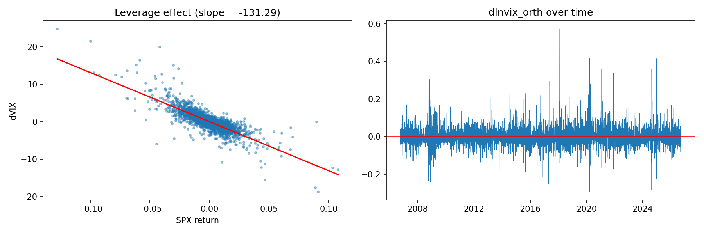
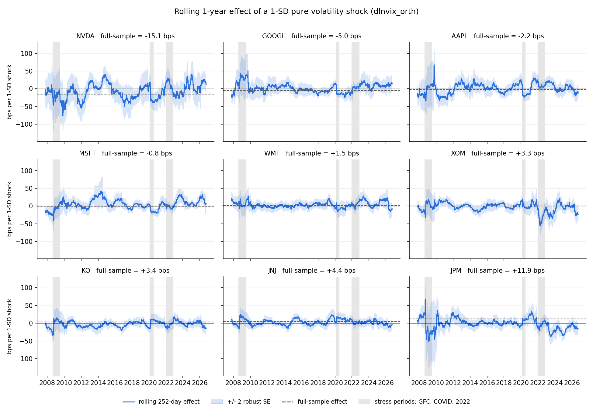
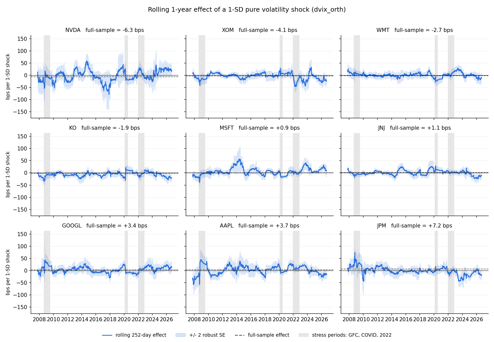

# Pure Volatility Shocks and Individual Stock Returns

How do individual stocks react, on the same day, to a jump in market volatility that the market's own move does not explain?

This project takes the market-driven part out of daily VIX moves (by orthogonalizing them against the S&P 500 return) and measures how nine large-cap U.S. stocks respond to what is left: a **pure volatility shock**. It uses 20 years of daily data (Oct 2006 to Sep 2026, 5,021 trading days), Newey-West standard errors, rolling one-year regressions, outlier checks, and Wald tests of stability across subperiods.

## Key findings

- **The shock moves money between stocks; it is not a broad selloff.** Once the market is controlled for, growth and defensive stocks move in opposite directions.
- **NVDA falls on pure volatility shocks** (about -15 bps per 1-SD shock, t = -4.1), and has done so consistently since 2006.
- **KO started rising on these shocks after 2020** (Wald p of 0.003 or less in every outlier version). JNJ shows the same shift, but it misses the multiple-testing cutoff.
- **JPM rises on these shocks** (+12 bps, t = 2.75), but almost all of the effect comes from 2006 to 2012.
- **How the shock is measured decides the result.** In VIX points the effect looks like nothing, because a few crisis days dominate. Measured as log (percent) changes, the pattern appears.

## Question and scope

On any day a stock is moved by two related forces: the overall market (SPX) and market volatility (VIX). They are tangled, because when the market falls the VIX almost always jumps. The project asks what a volatility move does to a stock **once the market's move is held fixed**, whether that response differs across stocks, and whether it is stable over time.

This is an **exposure** study, not a pricing study: it does not test whether volatility-sensitive stocks earn different average returns, which is the question in Ang, Hodrick, Xing and Zhang (2006). It is also not a forecasting study, since every effect is measured on the same day as the shock.

## Data

| Series | Description | Used as |
| --- | --- | --- |
| SPX | S&P 500 cash index | daily log return (market factor) |
| VIX | CBOE volatility index | daily point change and log change |
| AAPL, MSFT, NVDA, GOOGL | tech / growth | daily log returns |
| JPM | bank | daily log return |
| XOM | energy | daily log return |
| WMT, KO, JNJ | retail / staples (defensives) | daily log returns |

Daily bars come from Interactive Brokers via `pull_data.py`. The stocks were picked by hand to span a range of expected volatility sensitivities, so the results describe these names, not stocks in general.

## Method

**1. Returns and volatility moves.** Prices become log returns, and the VIX move is built two ways:

$$
r_t = \ln\frac{P_t}{P_{t-1}}, \qquad
\Delta \mathrm{VIX}_t = \mathrm{VIX}_t - \mathrm{VIX}_{t-1}, \qquad
\Delta \ln \mathrm{VIX}_t = \ln\frac{\mathrm{VIX}_t}{\mathrm{VIX}_{t-1}}
$$

The point change is dominated by the few days when VIX was already high. The log change (roughly a percent change) treats a move from 10 to 12 like one from 50 to 60, and it is the main specification.

**2. Orthogonalization.** Regress the VIX move on the market return and keep the residual $v_t$, the pure volatility shock:

$$
\Delta \mathrm{VIX}_t = \gamma_0 + \gamma_1 r^m_t + u_t, \qquad v_t = \hat u_t
$$

By construction $\mathrm{corr}(v_t, r^m_t) = 0$. The slope measures the leverage effect: a 1% SPX drop comes with about +1.3 VIX points, or about +4.6% in VIX ($R^2$ of 0.67 and 0.55).

**3. Stock exposures.** For each stock, with Newey-West (HAC, 5 lags) standard errors:

$$
r^i_t = \alpha_i + \beta_i r^m_t + \delta_i v_t + \varepsilon^i_t
$$

$\beta_i$ is the market beta and $\delta_i$ the volatility beta: the response to a pure shock with the market held fixed. By the Frisch-Waugh-Lovell theorem, $\delta_i$ comes out identical whether the raw or orthogonalized VIX move is used. What orthogonalizing changes is $\beta_i$, which becomes the plain market beta, and it gives $v_t$ a clean meaning. Effects are reported per one-standard-deviation shock, in basis points:

$$
\text{effect}_i = \hat\delta_i \, \sigma_v \times 10^4
$$

**4. Stability over time.** Rolling 252-day regressions, plus one regression in which every coefficient gets its own value in P1 (2006 to 2012), P2 (2013 to 2019) and P3 (2020 to 2026):

$$
r^i_t = \sum_{p=1}^{3} D_{p,t}\left(a_p + b_p r^m_t + d_p v_t\right) + \varepsilon_t
$$

A Wald test of $d_1 = d_2 = d_3$ (HAC covariance, $\chi^2_2$) checks whether the volatility beta changed. With nine stocks tested, the Bonferroni cutoff is $0.05/9 \approx 0.0056$.

**5. Outlier checks.** Everything is rerun four ways: as-is; with the shock capped at its 1st and 99th percentiles; without the 10 biggest shock days; and without the 1% of days with the biggest market moves.

## Results

| Finding | Effect (bps per 1-SD shock) | Robust to outliers? | Stable over time? | Verdict |
| --- | --- | --- | --- | --- |
| NVDA falls on shocks | -15.1 (t = -4.1) | yes, \|t\| from 2.6 to 4.1 | yes, Wald p from 0.10 to 0.59 | **robust and stable** |
| KO gains on shocks after 2020 | P3: +13.9 (t = 3.3) | yes | no, Wald p ≤ 0.003 in all versions | **robust change over time** |
| JPM gains on shocks | +11.9 (t = 2.75) | yes, t from 2.8 to 3.4 | concentrated in 2006 to 2012 | **real, but early period only** |
| JNJ gains on shocks after 2020 | P3: +15.8 (t = 3.4) | mostly | Wald p from 0.009 to 0.047 | suggestive |
| GOOGL falls on shocks | -5.0 (t = -2.3) | sign yes, significance no | no evidence of change | weak |
| AAPL, MSFT, WMT, XOM | small, mixed signs | | | no effect |

Measured in VIX points instead, no stock has a significant response, and 5 of 9 stocks flip sign compared with the log-change version.

**Leverage effect and the pure shock series**



**Rolling one-year response to a pure volatility shock (log change)**



**The same, measured in VIX points**



## Project structure

```
pull_data.py      pulls 20 years of daily bars from Interactive Brokers into data/
main.py           runs the full analysis on data/ and writes results/
data/             raw CSVs (one per symbol) + panel.csv
results/          tables (.csv) and charts (.png)
archive/          earlier one-step-at-a-time scripts
```

## How to run

```
pip install -r requirements.txt
python pull_data.py     # only if data/ is empty; needs TWS or IB Gateway running on port 7497
python main.py          # runs every stage, about a minute
```

`pull_data.py` needs an IBKR account with market data permissions for the SPX and VIX indices. `main.py` runs six stages in order: build the panel, diagnostics, orthogonalize the volatility shocks, full-sample betas, rolling betas, and the robustness and stability tests. It prints each stage and writes:

| Output | Contents |
| --- | --- |
| `results/full_sample_betas.csv` | alpha, market beta, R², and point vs log shock effects per stock |
| `results/rolling_betas_*.csv` / `.png` | rolling one-year effects for each shock definition |
| `results/robust_full_sample.csv` | full-sample effects under the four outlier versions |
| `results/robust_subperiods.csv` | P1 / P2 / P3 effects and Wald p-values under each version |
| `results/orthogonalization.png` | leverage-effect scatter and the pure shock series |

## Limitations

- **Small, hand-picked basket.** "Growth falls on shocks" rests mostly on NVDA.
- **Same day only.** Nothing here says whether shocks predict future returns.
- **Calendar subperiods.** The P1 / P2 / P3 boundaries were chosen by calendar year, not estimated from the data.
- **Asymmetry untested.** The 10 largest shocks were all VIX spikes; up and down shocks may act differently.
- **Full-sample orthogonalization.** Within a single window $v_t$ is not exactly uncorrelated with the market. This does not bias $\delta_i$, since the market is in every regression.
- **Data check.** GOOGL's close on 2008-09-30 looks like a bad print and should be verified against a second source.

## References

- Ang, A., Hodrick, R. J., Xing, Y., and Zhang, X. (2006). The Cross-Section of Volatility and Expected Returns. *Journal of Finance*, 61(1), 259-299.
- Newey, W. K., and West, K. D. (1987). A Simple, Positive Semi-Definite, Heteroskedasticity and Autocorrelation Consistent Covariance Matrix. *Econometrica*, 55(3), 703-708.
- Frisch, R., and Waugh, F. V. (1933). Partial Time Regressions as Compared with Individual Trends. *Econometrica*, 1(4), 387-401.
- Lovell, M. C. (1963). Seasonal Adjustment of Economic Time Series and Multiple Regression Analysis. *Journal of the American Statistical Association*, 58(304), 993-1010.
